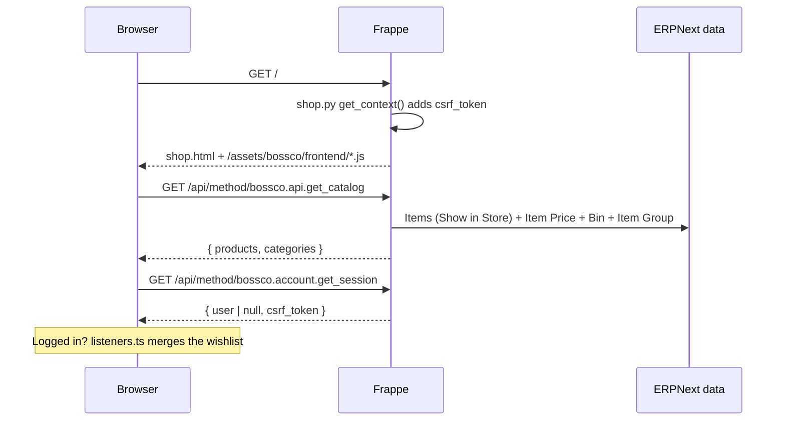
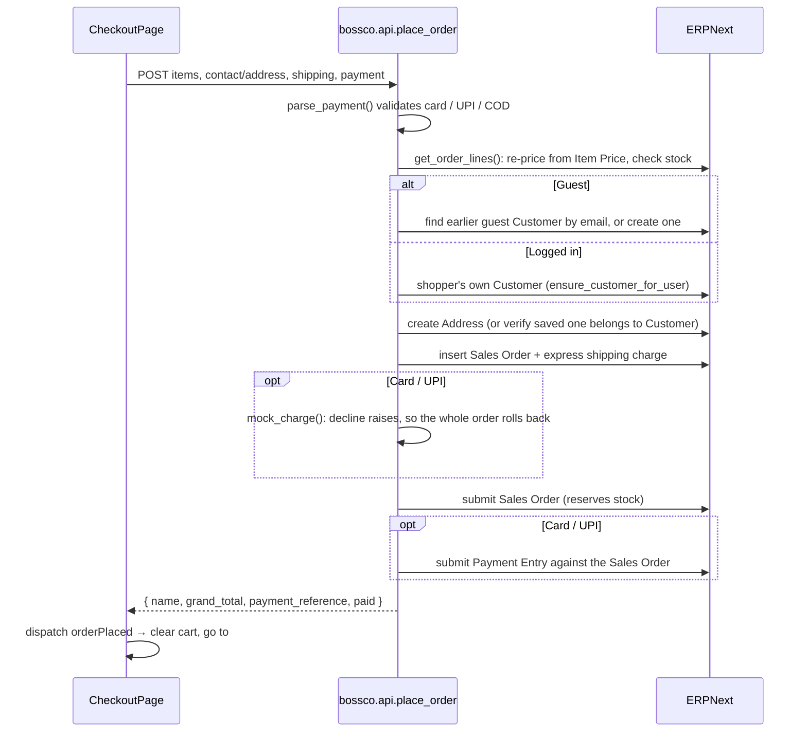

# How Bossco works: Frappe + React

This explains how the React storefront connects to Frappe/ERPNext, how a request travels from a button click to the database, and the main flows (catalog, login, checkout, wishlist). For installation and deployment, see the [README](../README.md).

## 1. The big picture

Bossco is two things in one Frappe app:

- **A React single-page app** (`frontend/`): everything the shopper sees.
- **A set of Python API methods** (`bossco/*.py`): the only way the React app reads or writes data.

There is no separate Node server or database. Frappe serves the React files, Frappe handles login sessions, and every product, customer, order and payment is a normal ERPNext document.

```
 Browser                                  Frappe (bench)                         ERPNext data
┌─────────────────────────┐            ┌──────────────────────────────┐      ┌──────────────────┐
│ React app               │  GET /     │ www/shop.py + www/shop.html  │      │ Item, Item Price │
│  ├─ pages / components  │──────────▶ │ (serves the app + CSRF token)│      │ Bin (stock)      │
│  ├─ Redux store         │            │                              │      │ Customer,Contact │
│  │   ├─ commerce (cart) │  /api/     │ bossco/api.py                │─────▶│ Address          │
│  │   └─ storeApi cache  │  method/…  │ bossco/account.py            │      │ Sales Order      │
│  └─ storeApi (RTK Query)│──────────▶ │ bossco/storefront.py, ...    │◀─────│ Payment Entry    │
└─────────────────────────┘  JSON      └──────────────────────────────┘      │ Wishlist Item    │
                                                                           └──────────────────┘
```

## 2. How Frappe serves the React app

### In production (after `bench build`)

1. `bench build --app bossco` runs the root `package.json` `build` script, which runs `yarn build` in `frontend/`.
2. Vite compiles the app into `bossco/public/frontend/`. Frappe publishes everything in an app's `public/` folder under `/assets/<app>/`, so the JS and CSS are served from `/assets/bossco/frontend/...`. That's why `vite.config.ts` sets `base: '/assets/bossco/frontend/'` for builds.
3. The build script then copies the built `index.html` to `bossco/www/shop.html`. Any file in an app's `www/` folder becomes a website page, so this one is served at `/shop`.
4. `hooks.py` sets `home_page = "shop"`, so `/` also serves the app.
5. Before sending `shop.html`, Frappe runs `bossco/www/shop.py` → `get_context()`, which puts the session's CSRF token into the page. `shop.html` is a Jinja template, so this line:

   ```html
   <script>window.csrf_token = '{{ csrf_token }}'</script>
   ```

   becomes the real token in the browser. React reads `window.csrf_token` and sends it with every POST.

`bossco/public/frontend/` and `bossco/www/shop.html` are generated files and are git-ignored.

### In development (`yarn dev`)

```
Browser ──▶ Vite dev server :8080 ──(proxy /api, /app, /assets, /files, /private, /login)──▶ bench serve :8000
```

- Vite serves the React source with hot reload on `http://localhost:8080`.
- Any request to a Frappe path is proxied to `bench serve`. The proxy adds the `X-Frappe-Site-Name` header (default `bossco.local`, override with `FRAPPE_SITE` / `FRAPPE_URL`) so the right site answers even if it isn't the bench's default.
- Because the browser only talks to `:8080`, cookies and requests are same-origin, the same as in production. No CORS setup is needed.
- Frappe doesn't render `index.html` here, so `window.csrf_token` stays as the literal text `{{ csrf_token }}`. The frontend ignores that placeholder and takes the token from the `get_session` response instead (see below).

## 3. How React talks to Frappe

### The URL pattern

Every Python function decorated with `@frappe.whitelist()` can be called over HTTP at:

```
/api/method/<python.dotted.path>
```

So `bossco/api.py → get_catalog()` is `GET /api/method/bossco.api.get_catalog`.

- `@frappe.whitelist(allow_guest=True)`: anyone can call it (catalog, login, sign up, place order).
- `@frappe.whitelist()`: the caller must be logged in (addresses, orders, wishlist, profile).
- `methods=["POST"]`: rejects GET, used for anything that changes data.
- `@rate_limit(...)`: used on login, sign up, forgot password and place order.

Arguments come from the query string (GET) or the JSON body (POST) and map to the function's parameters by name. Frappe wraps the return value as `{"message": <return value>}`.

### The API client: `frontend/src/features/api/storeApi.ts`

All server calls go through one RTK Query API slice. Components never call `fetch` directly. They use the generated hooks, for example `useGetCatalogQuery()` or `usePlaceOrderMutation()`.

What the slice does for every request:

| Concern | How it's handled |
|---|---|
| Base URL | `fetchBaseQuery({ baseUrl: '/api/method/' })`, so an endpoint is just `'bossco.api.get_catalog'` |
| Login cookie | `credentials: 'same-origin'`: the browser sends Frappe's `sid` cookie automatically |
| CSRF | `prepareHeaders` adds `X-Frappe-CSRF-Token` when a token is known |
| Response shape | `unwrap` turns `{ message: X }` into `X` |
| Errors | `getFrappeErrorMessage` reads Frappe's `_server_messages` (from `frappe.throw`) and returns plain text the UI can show in a toast |
| Caching | Tags `Catalog`, `Session`, `Address`, `Order`, `Wishlist`. Mutations invalidate tags, so related queries refetch on their own. For example, `placeOrder` invalidates `Order`, `Catalog` (stock changed) and `Address` |

### CSRF token lifecycle

Frappe requires a CSRF token on POST requests from a logged-in session, and **the token changes whenever the session changes** (login, sign up, logout).

1. First page load: the token comes from `window.csrf_token` (rendered by `shop.py`).
2. `get_session`, `login`, `sign_up`, `logout` and `update_profile` all return `csrf_token`. The `keepCsrfToken` hook stores it, and later requests use the new one.
3. Under `yarn dev`, step 1 is skipped (placeholder text) and step 2 provides the token.

If you add a new endpoint that logs someone in or out, return `get_session_info()` from Python and add `onQueryStarted: keepCsrfToken` on the frontend.

### Endpoint map

| Frontend hook | Python method | Who can call |
|---|---|---|
| `useGetCatalogQuery` | `bossco.api.get_catalog` | guest |
| `useGetStorefrontConfigQuery` | `bossco.api.get_storefront_config` (store name, announcement, shipping options) | guest |
| `useGetProductDetailsQuery` / `useGetRelatedProductsQuery` | `bossco.api.get_product` / `get_related_products` | guest |
| `useGetProductsQuery` | `bossco.api.get_products` (server-side filter/sort; not used by a page yet) | guest |
| `useGetCartQuoteQuery` | `bossco.api.get_cart_quote` (ERPNext-priced totals, coupon check, stock issues) | guest |
| `usePlaceOrderMutation` | `bossco.api.place_order` (+ `coupon_code`, `checkout_key`) | guest, POST |
| `useGetActiveOffersQuery` | `bossco.offers.get_active_offers` | guest |
| `useGetReviewsQuery`, `useSubmitReviewMutation`, `useVoteHelpfulMutation` | `bossco.reviews.*` | guest read, logged in write |
| `useResetPasswordMutation` | `frappe.core.doctype.user.user.update_password` (Frappe's own, key-checked) | guest, POST |
| `useSendContactMessageMutation`, `useSubscribeNewsletterMutation` | `frappe.www.contact.send_message`, `newsletter.subscribe` | guest, POST |
| (listeners only) | `bossco.cart.get_cart`, `set_cart`, `merge_cart` | logged in |
| `useGetSessionQuery` | `bossco.account.get_session` | guest |
| `useLoginMutation` / `useSignUpMutation` | `bossco.account.login` / `sign_up` | guest, POST |
| `useLogoutMutation` | `bossco.account.logout` | logged in, POST |
| `useForgotPasswordMutation` | `bossco.account.forgot_password` | guest, POST |
| `useUpdateProfileMutation` / `useChangePasswordMutation` | `update_profile` / `change_password` | logged in, POST |
| `useGetAddressesQuery`, `useSaveAddressMutation`, `useDeleteAddressMutation` | `get_addresses`, `save_address`, `delete_address` | logged in |
| `useGetOrdersQuery` | `bossco.account.get_orders` | logged in |
| (listeners only) | `get_wishlist`, `add_to_wishlist`, `remove_from_wishlist`, `merge_wishlist` | logged in |

## 4. State in the browser

`frontend/src/app/store.ts` sets up one Redux store with three parts:

| Slice | Holds | Persisted? |
|---|---|---|
| `theme` | light/dark mode | yes |
| `commerce` | cart lines, wishlist (item codes), shipping method, coupon code, recently viewed, last order | yes, in `localStorage` (`bossco:commerce`) |
| `ui` | cart drawer open state, badge pulse | no |
| `storeApi` | cached server responses (catalog, session, quote, offers, reviews, ...) | no, refetched |

The cart is kept in the browser and, for logged-in shoppers, mirrored to *Storefront Cart Item* (quantities only; prices always come from ERPNext). Totals shown anywhere come from `get_cart_quote` (`hooks/useCartQuote.ts`, debounced).

`frontend/src/app/listeners.ts` keeps the wishlist and cart in sync with the server:

- When a session with a user appears (page load while logged in, login, sign up), the local wishlist and cart are merged with `merge_wishlist` / `merge_cart`, and the server copies replace the local ones.
- When the heart button dispatches `toggleWishlist` and the shopper is logged in, the change is mirrored with `add_to_wishlist` / `remove_from_wishlist`; if the server refuses, the heart is rolled back.
- Cart changes are saved with `set_cart` a moment after the last change.
- On logout, `accountCleared` empties the wishlist, coupon and last order but keeps the cart.

## 5. Routing (hash-based)

The app uses `window.location.hash` instead of a router library (`app/router.ts` parses `#path/segment?query`), and `App.tsx` picks the page. Frappe always serves the same `shop.html`, so there are no server routes to keep in sync. Pages other than home and the catalog are lazy chunks, prefetched when a link to them is hovered or focused, and preloaded for deep links by a small inline script in `index.html` (see `vite.config.ts`).

| Hash | Page |
|---|---|
| (empty), `#home` | Home |
| `#honey?q=…&category=…&min=&max=&rating=&sizes=&stock=in&deals=1&sort=&page=` | Catalog; every filter lives in the URL (`features/catalog/catalogQuery.ts`) |
| `#reset-password?key=…` | Choose a new password (link from the reset email) |
| `#product/<slug>` | Product detail (slug = `Item.bossco_slug`) |
| `#cart`, `#checkout`, `#order-complete` | Cart, checkout, confirmation |
| `#wishlist` | Wishlist |
| `#login[/<next>]`, `#register[/<next>]` | Auth; after success goes to `#<next>` (default `#account`) |
| `#account[/account\|address\|orders\|wishlist]` | My Account (shows login if not signed in) |
| `#contact` | Contact |

## 6. How storefront concepts map to ERPNext

| Storefront | ERPNext / Frappe | Code |
|---|---|---|
| Product | `Item` with **Show in Store** ticked (custom fields in the Storefront tab) | `storefront.get_store_products` |
| Category | `Item Group` (tree; sub-groups included) | `storefront.get_store_categories` |
| Price | `Item Price` in the default selling price list | `storefront.get_prices` |
| Stock | `Bin`: actual qty minus reserved qty, all warehouses | `storefront.get_available_stock` |
| Shopper account | `User` (Website User, role *Customer*) | `account.sign_up` |
| Customer record | `Customer` + `Contact` (Contact.user = the User) | `customers.py` |
| Saved address | `Address` linked to the Customer | `account.save_address` |
| Order | `Sales Order`, submitted, order type *Shopping Cart* | `api.place_order` |
| Payment | `Payment Entry` against the Sales Order (mock gateway) | `payments.py` |
| Wishlist | `Storefront Wishlist Item` (custom DocType, one row per user + item) | `account.py` |
| Saved cart | `Storefront Cart Item` | `cart.py` |
| Review | `Storefront Review` (+ `Storefront Review Vote`); Item rating fields are derived | `reviews.py` |
| Promotion | `Storefront Offer` → ERPNext `Coupon Code` → `Pricing Rule` | `offers.py` |
| Invoice | `Sales Invoice` made by background jobs from the Sales Order / Delivery Note | `orders.py` |
| Store settings | `Storefront Settings` (single) | `api.get_storefront_config` |

Custom fields (`bossco_*` on Item and Sales Order) are created by `install.py` on install and on every `bench migrate`. The `Item` `validate` hook in `hooks.py` gives each store item a unique URL slug.

`get_store_products` is the one place that turns ERPNext rows into the JSON shape React expects (`frontend/src/types/catalog.ts`). If you add a product field, add it in both places.

## 7. The main flows

### Opening the site



### Sign up / login

1. `AuthPage` calls `signUp` or `login`.
2. **Sign up** (`account.sign_up`): creates a Website User with the *Customer* role, creates their `Customer` and `Contact` (`ensure_customer_for_user`), then logs them in with `login_as`.
   **Login** (`account.login`): Frappe's `LoginManager` checks the password and starts a session.
3. Frappe sets the `sid` cookie, and the response carries the new CSRF token.
4. RTK Query invalidates `Session`, `Address`, `Order` and `Wishlist`, so the header, account page and wishlist refresh. The listener merges the guest wishlist into the account.

### Checkout



Key rules:

- **The browser never sets prices.** It sends only `item_code` and `qty`. The server reads prices from ERPNext and checks stock.
- **One request, one transaction.** Frappe commits at the end of a successful request and rolls back on any exception. A declined payment or a stock error means no Sales Order, no Address and no Customer are left behind.
- **Guests can't attach orders to a registered account.** Guest matching only looks at Contacts with no linked user.

### My Account and order status

`account.get_orders` reads the shopper's Sales Orders and translates ERPNext's state:

| ERPNext | Shown as |
|---|---|
| Draft (docstatus 0) | Awaiting confirmation |
| Submitted | Processing |
| Partly / fully delivered (Delivery Note) | Partly shipped / Delivered |
| Cancelled | Cancelled |

So staff fulfil orders in ERPNext Desk as usual (Delivery Note, Sales Invoice), and the shopper's account page follows along.

## 8. Adding a new feature (recipe)

Say you want a "Recently viewed" API.

1. **Python**: add a function in `bossco/api.py` (public) or `bossco/account.py` (needs login):

   ```python
   @frappe.whitelist()
   def get_recently_viewed():
       ...
       return rows
   ```

   - Use `allow_guest=True` only if guests really need it.
   - Add `methods=["POST"]` if it changes data.
   - If you use `ignore_permissions=True`, check ownership yourself first (see `validate_address_owner`).
   - Report errors with `frappe.throw(_("..."))`. The frontend will show the message.

2. **Types**: describe the response in `frontend/src/types/`.

3. **API slice**: add an endpoint in `storeApi.ts`:

   ```ts
   getRecentlyViewed: build.query<Product[], void>({
     query: () => 'bossco.account.get_recently_viewed',
     transformResponse: unwrap<Product[]>,
     providesTags: ['Catalog'],
   }),
   ```

   For mutations, also add `transformErrorResponse: (error) => getFrappeErrorMessage(error.data)` and the right `invalidatesTags`.

4. **Component**: export and use the hook, `const { data } = useGetRecentlyViewedQuery()`.

5. **Run it**: with `bench serve` and `yarn dev` running, the change is live on `:8080`. Python changes reload with `bench serve`. New custom fields need `bench --site <site> migrate`.

## 9. Things that trip people up

- **`CSRFTokenError` on POST**: the token changed (someone logged in or out in another tab) or a new auth endpoint doesn't return `csrf_token`. Reloading the page fixes the first case.
- **Products missing from the store**: the Item needs *Show in Store*, must not be disabled or a template with variants, and must have an Item Price in the default selling price list.
- **Changes don't show on the bench site (`:8000`)**: that serves the last *build*. Run `bench build --app bossco`, or use `yarn dev` on `:8080`.
- **`yarn dev` shows the wrong site's data**: set `FRAPPE_SITE=<your-site> yarn dev`.
- **Express orders fail**: the company needs a *Freight and Forwarding Charges* account (ERPNext's standard chart of accounts has one).
- **Card/UPI orders fail**: the *Credit Card* / *UPI* Modes of Payment need a default account for the company. `bench --site <site> execute bossco.demo.seed` sets these up.
